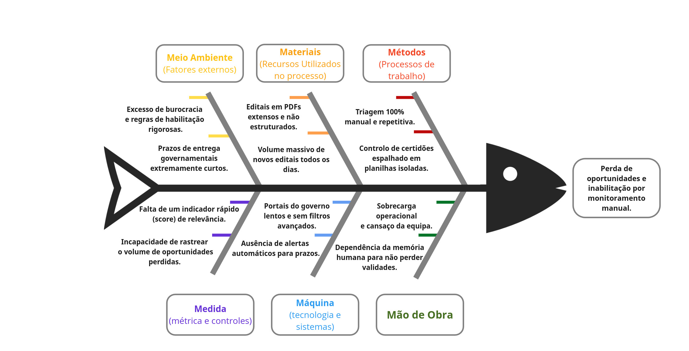
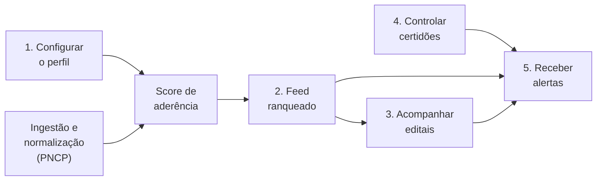

# Visão e Escopo do Produto

## Resumo

O LicitaRadar é uma plataforma SaaS B2B que ajuda PMEs a participar de compras públicas. Ele ingere e ranqueia os editais do PNCP por aderência ao perfil da empresa, monitora a validade das certidões de habilitação e avisa sobre oportunidades e vencimentos. A fonte de dados é o PNCP, o portal oficial instituído pela Nova Lei de Licitações (Lei nº 14.133/2021).

---

## Cenário atual do cliente e do negócio

### Introdução ao negócio e contexto

O LicitaRadar é uma plataforma SaaS B2B focada em otimizar a participação de Pequenas e Médias Empresas (PMEs) no setor de compras públicas. No cenário atual, fornecer para o governo exige o acompanhamento diário e rigoroso de plataformas governamentais, como o Portal Nacional de Contratações Públicas (PNCP).

O público-alvo da solução são empresas fornecedoras que já atuam ou desejam ingressar no mercado de licitações, mas que sofrem com a sobrecarga operacional da equipe comercial e com a falta de ferramentas inteligentes para prospecção. O sistema atua como um assistente que automatiza a busca, a triagem e o ranqueamento de editais, além de monitorar preventivamente a validade das certidões da empresa e alertar sobre as oportunidades de contratação.

### Identificação da oportunidade ou problema

O projeto é necessário porque o processo de prospecção atual das PMEs é altamente manual, reativo e ineficiente. Todos os dias, um grande volume de novas oportunidades é publicado no PNCP. O LicitaRadar resolve duas grandes dores operacionais e financeiras que afetam as empresas:

| Dor | Tipo de impacto | O que acontece |
| :--- | :--- | :--- |
| **Perda de oportunidades** | Custo de oportunidade | Devido ao volume massivo de dados e ao esforço manual de leitura, editais altamente lucrativos passam despercebidos ou são descobertos quando já não há tempo hábil para montar uma proposta. |
| **Inabilitação por falhas de controle** | Risco operacional | A gestão das certidões de habilitação costuma ser feita de memória ou em planilhas isoladas. Descobrir que um documento está vencido na véspera da entrega resulta em desclassificação imediata no certame. |

A oportunidade de mercado explorada pelo LicitaRadar é transformar essa rotina exaustiva em um processo automatizado e focado em inteligência de dados, garantindo que as empresas vejam primeiro as licitações com maior probabilidade de vitória.

A figura a seguir apresenta o diagrama de Ishikawa, com as causas organizadas pelos 6Ms e o problema.

<em>Figura 1 – Diagrama de Ishikawa do problema (6Ms).</em>

### Desafios do projeto e riscos técnicos

- **Técnico:** o principal desafio é a ingestão, a normalização e o processamento diário do volume massivo de dados provenientes da API do PNCP. Como serviços governamentais podem apresentar instabilidades, será necessário implementar mecanismos de resiliência (como *retry*) para garantir a estabilidade. É necessário garantir que o cálculo do Score de Aderência seja determinístico e eficiente, sem sobrecarregar a infraestrutura e mantendo o custo de nuvem abaixo do limite de US$ 50.
- **Operacional:** promover a transição cultural nas empresas clientes, substituindo a dependência de métodos manuais, memória humana e planilhas isoladas por um fluxo de trabalho automatizado.
- **Gestão de escopo:** exige disciplina da equipe para restringir o desenvolvimento inicial estritamente ao Produto Mínimo Viável (MVP), evitando a construção de funcionalidades não prioritárias.

### Riscos do projeto

| Risco | Probabilidade | Impacto | Mitigação |
| :--- | :---: | :---: | :--- |
| Instabilidade ou mudança na API do PNCP | Média | Alto | *Retry* com reprocessamento, ingestão idempotente e registro das falhas de cada coleta |
| Estouro do teto de custo de US$ 50 | Média | Alto | Arquitetura serverless, alertas de orçamento em 50%, 80% e 100% e acompanhamento semanal do gasto |
| Escopo maior que a capacidade do ciclo | Alta | Alto | Priorização MoSCoW, entrega em ondas e regra de corte por prioridade |
| Prazo curto, de aproximadamente 2 meses | Média | Alto | ScrumXP, checkpoints quinzenais e automação de testes e CI/CD |
| Pouco acesso a fornecedores para validar o produto | Média | Médio | Planejar as entrevistas desde o início e validar perfis e personas com usuários reais |

*Probabilidade e impacto são estimativas iniciais, a revisar a cada checkpoint.*

### Segmentação de clientes

O LicitaRadar atende a dois perfis complementares dentro das PMEs:

| | O Decisor | O Usuário Operacional |
| :--- | :--- | :--- |
| **Quem é** | Sócio ou diretor comercial | Analista de licitações |
| **Papel** | Comprador e patrocinador da plataforma | Quem usa a plataforma diariamente |
| **Foco** | Estratégico: Retorno sobre o Investimento (ROI) e mitigação de riscos operacionais | Operacional: agilidade, usabilidade e filtros precisos |
| **Necessidade** | Ferramentas que protejam a empresa de inabilitações por certidões vencidas e que ofereçam uma visão rápida das licitações mais lucrativas | Fugir da triagem manual e da leitura exaustiva de editais, para dedicar o tempo à elaboração de propostas em vez da procura básica |

---

## Conformidade com a LGPD

Para garantir a total adequação à Lei Geral de Proteção de Dados (LGPD) no contexto do nosso SaaS B2B, o LicitaRadar adota a seguinte política de minimização e retenção:

* **Quais dados guardamos:** Apenas os dados estritamente necessários para a operação das contas corporativas: Nome, Cargo e E-mail corporativo dos perfis Decisor e Analista.
* **Porquê guardamos:** Os dados são utilizados exclusivamente para o processo de autenticação, gestão de acessos baseada em hierarquia (Administrador vs. Convidado) e envio de alertas operacionais do sistema.
* **Durante quanto tempo:** Os dados pessoais são mantidos apenas durante o período em que a subscrição da organização (PME) estiver ativa. Em caso de cancelamento, os dados da empresa e dos seus respetivos utilizadores são eliminados de forma segura num prazo de 30 dias.

---

##  Defensibilidade (Vantagem Competitiva)

Para garantir a proteção do nosso modelo de negócio contra concorrentes que tentem copiar as nossas funcionalidades amanhã, o LicitaRadar baseia a sua defensibilidade na métrica de **Custo de Mudança (*Switching Cost*) impulsionado pelo Histórico de Uso**.

À medida que a PME interage com a plataforma (aprovando editais ou descartando recomendações), o sistema acumula o histórico de decisões e o repositório de certidões validadas. Um concorrente que copie a interface da nossa plataforma não terá acesso a este histórico comportamental e documental. Consequentemente, entregará resultados menos calibrados nos primeiros meses, exigindo que a PME "pague" o custo de tempo de recomeçar a ensinar as suas preferências e a carregar todos os seus documentos legais do zero noutra ferramenta.

## Solução proposta

### Objetivo do produto

O objetivo do LicitaRadar é atuar como um assistente inteligente que automatiza o processo de vendas governamentais para PMEs. A plataforma visa eliminar o esforço manual de procura ao ingerir e ranquear automaticamente os editais do PNCP. Simultaneamente, o produto busca mitigar o risco de inabilitação por meio do acompanhamento e da notificação proativa dos prazos de validade das certidões da empresa.

### Características da solução

A solução baseia-se em um Produto Mínimo Viável (MVP) organizado em cinco jornadas centrais de alto valor para o usuário:

1. **Configurar o perfil:** a empresa define termos-chave, UFs, modalidades e faixa de valor, que alimentam o ranqueamento.
2. **Explorar o feed ranqueado:** apresentação das licitações da maior para a menor relevância, com filtros, poupando horas de triagem manual.
3. **Acompanhar editais:** registro das etapas de preparação de cada edital de interesse, até o prazo.
4. **Controlar certidões:** controle do prazo de validade das certidões de habilitação, classificando-as visualmente como válidas, a vencer ou vencidas.
5. **Receber alertas:** notificações proativas dentro da plataforma, avisando sobre oportunidades de alta aderência e certidões próximas do vencimento.

Duas capacidades técnicas sustentam essas jornadas:

- **Ingestão e normalização (PNCP):** coleta periódica, automática e idempotente dos dados do portal do governo, estruturando as informações relevantes.
- **Cálculo do Score de Aderência:** algoritmo determinístico que cruza o perfil configurado pela empresa (termos-chave, UF, modalidade e valor) com os editais disponíveis.

### Fora do escopo do MVP

Para manter o foco e entregar com qualidade dentro do ciclo, os itens abaixo **não** fazem parte deste MVP:

- Envio de propostas.
- Robô de lances.
- OCR ou IA sobre o texto dos editais.
- Outros portais além do PNCP.

### Tecnologias a serem usadas

O desenvolvimento do LicitaRadar foi planejado com foco em modernidade, escalabilidade e segurança. A arquitetura fará uso das seguintes tecnologias:

| Camada | Tecnologias | Papel na solução |
| :--- | :--- | :--- |
| **Front-end** | React, Vite, TypeScript, Tailwind CSS, Firebase Hosting | React com Vite como empacotador, para alta performance; TypeScript para tipagem estática; Tailwind CSS para estilização e design responsivo; distribuição do conteúdo estático via Firebase Hosting |
| **Back-end** | Node.js, TypeScript, Fastify, Zod, Google Cloud Run | API no ecossistema Node.js; Fastify pelo alto desempenho; Zod para validação rigorosa de esquemas de dados; execução serverless no Cloud Run, com escalabilidade automática |
| **QA e ambiente local** | Firebase Emulator Suite, Vitest, Playwright | Desenvolvimento local que simula os serviços de backend sem custos; Vitest para testes unitários e de lógica de negócio; Playwright para fluxos de ponta a ponta (E2E) e de interface |
| **DevOps e segurança** | GitHub Actions, Firebase CLI, Cloud Run, Google Secret Manager | CI/CD orquestrado via GitHub Actions; Firebase CLI nos deploys do front-end e Cloud Run para os serviços em nuvem; credenciais sensíveis protegidas pelo Secret Manager |

### Pesquisa de mercado e análise competitiva

No mercado de monitoramento de compras públicas, existem plataformas consolidadas que oferecem a captura de editais, mas que apresentam falhas de usabilidade ou de foco estratégico para PMEs. Os principais concorrentes são:

| Concorrente | Foco do negócio | Limitação para uma PME |
| :--- | :--- | :--- |
| **ConLicitação** | Plataforma antiga e robusta, baseada na entrega de um volume massivo de resultados | Obriga o usuário a perder horas lendo e filtrando as oportunidades manualmente; custo elevado para empresas de menor porte |
| **Effecti / Siga Pregão** | Plataformas mais modernas, com foco na automação de lances (robôs de disputa) | Excessivamente complexas e caras para quem só precisa descobrir boas oportunidades e se organizar para participar; oferecem funcionalidades (como os robôs) de que o cliente não necessita |

*Fonte: análise da equipe a partir dos sites dos concorrentes (inserir links e data de consulta).*

#### Como o LicitaRadar se diferencia

Enquanto os concorrentes focam em volume de dados ou em automação de lances, o LicitaRadar combina curadoria inteligente com gestão de risco:

1. **Score de Aderência:** em vez de entregar uma lista infinita de editais, o sistema usa um algoritmo para ranquear as oportunidades, colocando no topo apenas as que realmente fazem sentido para o perfil da empresa (termos, UF e valor).
2. **Controle integrado de certidões:** a concorrência foca apenas em encontrar o edital. O LicitaRadar acompanha o usuário até a fase de habilitação, emitindo alertas proativos sobre o vencimento das certidões e evitando que a empresa seja desclassificada por falhas burocráticas.
3. **Foco exclusivo nas PMEs:** interface simples, sem excesso de funcionalidades complexas, pensada para o decisor (ROI) e para o analista (agilidade).

### Análise de viabilidade

A construção do LicitaRadar é sustentável e adequada ao ciclo atual, com base em quatro pilares:

- **Viabilidade técnica:** a arquitetura definida pela equipe usa tecnologias modernas, robustas e de alto desempenho, como React no front-end, Node.js com Fastify no back-end e hospedagem no Google Cloud Run. A integração de dados é viável graças à disponibilidade estruturada da API do PNCP, ainda que exija tolerância a falhas. Além disso, o Firebase Emulator Suite permite simular o banco de dados localmente, mitigando riscos técnicos durante a construção.
- **Viabilidade de prazo:** o ciclo de desenvolvimento é curto, com entrega em aproximadamente 2 meses. O cronograma é viável pela aplicação rigorosa da matriz de priorização MoSCoW, que blinda o escopo do MVP para que apenas as jornadas essenciais (Must Have) sejam desenvolvidas até o fim do ciclo, evitando atrasos.
- **Viabilidade financeira:** o risco financeiro é baixo. Na fase inicial, os testes ocorrem 100% localmente, por meio de emuladores e Docker, com custo zero. No deploy e na produção, a arquitetura serverless otimizada mantém o custo total de nuvem dentro da estimativa de US$ 10 a US$ 20, de forma sustentável e abaixo do teto de US$ 50 por equipe.
- **Viabilidade de mercado:** existe uma demanda latente das PMEs por soluções de vendas governamentais simples, acessíveis e focadas em resultados. Enquanto os concorrentes focam em complexidade ou apenas em volume de dados, o LicitaRadar demonstra alta adequação ao mercado ao resolver as dores diretas de forma proativa (Score de Aderência e alertas de certidão), favorecendo a rápida adoção pelos usuários.

**Custo por etapa**

| Etapa | Custo |
| :--- | :--- |
| Desenvolvimento local (emuladores e Docker) | US$ 0 |
| Checkpoint 3 (sistema na nuvem) | Gasto acumulado ≤ US$ 12 |
| Estimativa total de nuvem no ciclo | US$ 10 a US$ 20 |
| Teto por equipe | US$ 50 |
| Alertas de orçamento no GCP | 50% (US$ 25), 80% (US$ 40) e 100% (US$ 50) |

### Critérios de sucesso do MVP

O MVP será considerado bem-sucedido se, na demonstração:

1. Dois perfis de empresa diferentes receberem feeds diferentes e coerentes com o seu perfil.
2. A relevância dos dez primeiros resultados for medida para cada perfil.
3. Certidões vencidas ou a vencer gerarem alerta nos dados de teste.
4. O custo de nuvem permanecer abaixo do teto de US$ 50.
5. As metas de qualidade do Checkpoint 4 forem atingidas: cobertura de domínio ≥ 80%, zero vulnerabilidades críticas e Lighthouse ≥ 90.

### Impacto da solução

A implementação do LicitaRadar traz uma transformação direta nos resultados operacionais e financeiros das PMEs clientes. Ao substituir um modelo de prospecção governamental manual e reativo por uma abordagem proativa e orientada por dados, a solução otimiza o tempo da equipe comercial.

#### Eficiência comercial e ROI

Analistas de licitações, que antes gastavam horas na leitura exaustiva de PDFs extensos e na configuração repetitiva de filtros em portais lentos, poderão redirecionar o foco para a elaboração de propostas mais refinadas e competitivas. Ao mesmo tempo, a priorização inteligente do Score de Aderência aumenta o ROI da empresa, pois os diretores comerciais concentram recursos e energia nos editais mais lucrativos e com maior probabilidade real de vitória.

#### Segurança operacional e mitigação de riscos

O controle de prazos das certidões de habilitação, centralizado e automatizado pela plataforma, elimina a dependência de planilhas isoladas e da memória humana. Esse monitoramento contínuo protege a empresa contra desclassificações inesperadas, assegurando que nenhum esforço comercial ou oportunidade já garantida seja desperdiçado por falhas burocráticas de última hora na documentação.

---

## Estratégias de engenharia de software

### Estratégia priorizada

| Item | Escolha |
| :--- | :--- |
| **Abordagem de desenvolvimento** | Ágil |
| **Ciclo de vida** | Iterativo e incremental |
| **Processo de engenharia de software** | ScrumXP, uma abordagem híbrida que combina o modelo de gestão e as cerimônias do Scrum com as rigorosas práticas de engenharia do Extreme Programming (XP) |

### Quadro comparativo

O quadro abaixo compara o **OpenUP** (processo ágil mais estruturado e focado na arquitetura inicial) com o **ScrumXP** (focado em entregas rápidas e excelência técnica), avaliando qual se adapta melhor ao cenário do LicitaRadar.

| Características | OpenUP | ScrumXP |
| :--- | :--- | :--- |
| **Abordagem geral** | Iterativo e incremental, mas baseado em uma arquitetura sólida e definida logo nas fases iniciais (Iniciação, Elaboração, Construção e Transição). | Iterativo e incremental, com foco máximo em entregas rápidas (sprints curtas), *feedback* contínuo e adaptação constante. |
| **Flexibilidade de requisitos** | Oferece flexibilidade iterativa, mas exige que a fundação e os requisitos arquiteturais estejam bem consolidados antes da fase de Construção. | Alta flexibilidade. O *backlog* (MoSCoW) pode ser ajustado e repriorizado a cada sprint para garantir a entrega de valor imediata ao cliente. |
| **Práticas técnicas e qualidade** | A qualidade é assegurada por revisões formais de arquitetura em cada fase e por documentação mais pesada. | Alta ênfase na excelência técnica no dia a dia: Integração Contínua (CI/CD), revisões de código (Pull Requests) e testes automatizados (TDD/E2E). |
| **Complexidade e documentação** | Processo mais formal. Exige maior disciplina documental em cada fase e separação de papéis mais rígida. | Processo leve. A documentação se restringe ao essencial (como ADRs e Visão de Produto) e a equipe atua de forma colaborativa e autoorganizada. |
| **Adaptação ao LicitaRadar** | Ideal para um projeto de longo prazo, com requisitos imutáveis e alta complexidade arquitetural, em que o tempo não fosse um fator restritivo. | Ideal para o ciclo extremamente curto (aproximadamente 2 meses), que exige validações rápidas e qualidade técnica garantida pela automação. |

### Justificativa

A escolha do ScrumXP fundamenta-se na necessidade de aliar entregas rápidas à excelência técnica, uma exigência de um ciclo restrito a aproximadamente dois meses. Ao contrário de abordagens mais formais, o ScrumXP permite que a equipe valide funcionalidades de forma contínua por meio de sprints curtas, com flexibilidade para repriorizar o escopo do MVP conforme as restrições de tempo.

Além disso, a metodologia se integra bem à infraestrutura definida, incorporando práticas essenciais do XP, como o desenvolvimento orientado a testes e a automação de processos via CI/CD. Dessa forma, é possível mitigar riscos técnicos e financeiros desde as primeiras semanas, assegurando que a complexidade da integração com o portal governamental seja gerida com alta qualidade e sem o peso de uma documentação excessiva.

---

## Cronograma e entregas

O cronograma do LicitaRadar foi estruturado em nove sprints semanais, agrupadas em checkpoints quinzenais. O planejamento reflete os checkpoints oficiais do ciclo B2B (de 04/10/2026 a 05/12/2026), garantindo a entrega incremental de valor e o controle estrito do orçamento.

| Sprint | Início | Fim | Foco / checkpoint oficial |
| :--- | :---: | :---: | :--- |
| **Sprints 1 e 2** | 04/10/2026 | 18/10/2026 | **Checkpoint 1: Fundação**, para validar problema, escopo, arquitetura e base técnica |
| **Sprints 3 e 4** | 19/10/2026 | 01/11/2026 | **Checkpoint 2: Núcleo Funcional**, para validar o núcleo do produto funcionando localmente |
| **Sprints 5 e 6** | 02/11/2026 | 15/11/2026 | **Checkpoint 3: Nuvem e Integração**, para validar o sistema publicado e observável |
| **Sprints 7 e 8** | 16/11/2026 | 29/11/2026 | **Checkpoint 4: Estabilização**, para tornar o MVP confiável e garantir a qualidade técnica |
| **Sprint 9** | 30/11/2026 | 05/12/2026 | **Demo Day**, para homologar, demonstrar e apresentar o produto |

### Entregas esperadas por checkpoint

=== "1. Fundação"

    - Documentação concluída (Visão do Produto, MoSCoW, Ishikawa, entrevistas).
    - Arquitetura definida (4 ADRs base e OpenAPI v0.1).
    - Ambiente local funcional (Docker Compose com API, front-end e emuladores do Firebase).
    - Segurança e custos configurados (`.env.example`, alertas de orçamento no GCP em 50%, 80% e 100%).

=== "2. Núcleo funcional"

    - De 3 a 5 jornadas principais funcionando de ponta a ponta em ambiente local.
    - API integrada ao front-end, com estados de carregamento, vazio e erro.
    - Security Rules (deny-all) aplicadas nos emuladores.
    - Matriz de rastreabilidade (requisito → teste) e relatórios iniciais de QA gerados.

=== "3. Nuvem e integração"

    - Deploy realizado: Firebase Hosting e Google Cloud Run.
    - Observabilidade configurada (logs em JSON e rotas `/healthz` e `/readyz`).
    - Segurança em nuvem garantida (Identity Federation e Secret Manager).
    - Sistema funcional para o usuário final na nuvem, com gasto acumulado ≤ US$ 12.

=== "4. Estabilização"

    - Pipeline de CI/CD bloqueante (lint, build, testes e varredura de segredos).
    - Metas de qualidade atingidas: cobertura de domínio ≥ 80%, zero vulnerabilidades críticas e Lighthouse ≥ 90.
    - Plano de contingência pronto (rollback ensaiado e dados controlados).

=== "Demo Day"

    - Fluxo de negócio fluido em ambiente de produção.
    - Roteiro de demonstração preparado (Certidões e habilitação, Feed, Alertas e snapshot de custos).
    - Lançamento e validação final da plataforma LicitaRadar.

!!! note "Planejamento preliminar"

    O planejamento atual tem caráter preliminar e será atualizado continuamente nas reuniões de revisão e repriorização do backlog, de acordo com as metodologias ágeis adotadas pela equipe.

---

## Interação entre equipe e cliente

### Composição da equipe

| Papel | Responsável | Responsabilidades |
| :--- | :--- | :--- |
| **Product Owner (PO)** | Maria Júlia Sena | Representa o usuário final (sócio e analista), prioriza o *backlog* (MoSCoW), garante o alinhamento com a Visão do Produto e valida os critérios de aceite |
| **Tech Lead** | Júlia Neiva | Lidera as decisões de arquitetura (ADRs), a modelagem de dados e a infraestrutura |
| **Desenvolvedores Full Stack** | João Paulo Barbosa, Luis Felipe Albuquerque, Kauan Tarchetti e Giovanni Dornelas | Atuam em todas as camadas: front-end (React), back-end (Fastify), testes automatizados e pipeline de CI/CD |

### Comunicação

Para garantir transparência e fluidez no processo híbrido (ScrumXP), a equipe interage com os tutores e stakeholders do AI Lab, que fazem o papel de cliente do ciclo B2B e validam as entregas nos checkpoints. A PO representa o usuário final nas decisões de priorização.

#### Ferramentas

| Ferramenta | Uso |
| :--- | :--- |
| **WhatsApp** | Canal oficial da comunicação diária assíncrona da equipe, resolução rápida de bloqueios técnicos e avisos de *deploys* |
| **Google Meet** | Cerimônias síncronas do Scrum (planejamento, revisão e retrospectiva) e reuniões formais de validação nos checkpoints |
| **GitHub (Projects/Issues)** | Ferramenta central para planejamento das sprints, acompanhamento do Kanban, gestão do *backlog* de histórias de usuário e revisão de código (*Pull Requests*) |

#### Métodos e frequência de interação

- **Reuniões de alinhamento semanal:** reuniões curtas, de 20 a 30 minutos, para avaliar o que foi concluído, registrar bloqueios, gerir riscos e acompanhar o orçamento de nuvem.
- **Revisões de checkpoint (quinzenais):** coincidem com as datas de entrega dos checkpoints do ciclo B2B, quando a equipe apresenta as jornadas funcionais desenvolvidas para validação externa.
- **Comunicação técnica contínua:** a equipe técnica interage diariamente por meio de *code reviews* obrigatórios no GitHub antes de qualquer integração na branch principal (`main`).

### Processo de validação

O LicitaRadar adota um processo de qualidade em múltiplas camadas. O produto só é considerado "Pronto" quando atende às expectativas do negócio e aos requisitos de engenharia:

1. **Definition of Ready (DoR):** nenhuma tarefa entra em desenvolvimento sem estar claramente definida no *backlog*, com critérios de aceite mensuráveis e prioridade validada pela PO.
2. **Definition of Done (DoD) técnico:** o código só é aceito se passar em 100% dos testes automatizados executados pelo CI do GitHub Actions (*lint* e *build* verdes) e se receber a aprovação manual (*code review*) de pelo menos um membro da equipe diferente do autor.
3. **Homologação local (emuladores):** antes de consumir recursos na nuvem, todas as jornadas são testadas isoladamente, com dados simulados no Firebase Emulator Suite e instâncias via Docker Compose, garantindo a reprodutibilidade.
4. **Validação final de negócio:** ao final de cada checkpoint, o sistema é demonstrado em um fluxo de ponta a ponta (E2E). O produto só é validado se o comportamento respeitar estritamente as regras de segurança (*Security Rules*) e o isolamento de clientes (*tenant*), e se o custo operacional de nuvem ficar dentro das metas de cada etapa, sempre abaixo do teto de US$ 50.

---

## Histórico de Versões

| Versão | Data | Descrição | Autor |
| :---: | :---: | :--- | :--- |
| `1.0` | 09/10/2026 | Versão inicial da Visão e Escopo do Produto | Maria Júlia Sena |
| `1.1` | 14/10/2026 | Revisão de estrutura e formatação, sem alteração de conteúdo | Maria Júlia Sena |