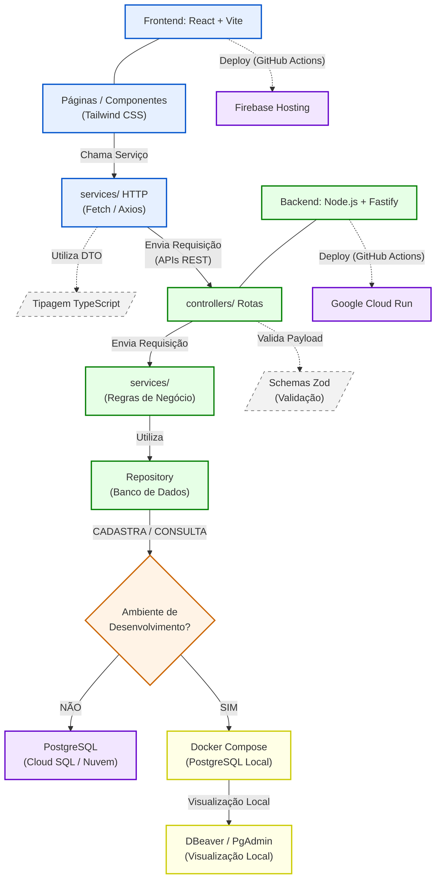

# Visão Geral da Arquitetura

O MVP do LicitaRadar foi desenhado com base numa arquitetura moderna, escalável e desacoplada (separação clara entre *Frontend* e *Backend* através de uma API REST). Esta abordagem garante que o sistema seja rápido de desenvolver na fase do AI Lab, mas robusto o suficiente para crescer.

A arquitetura está dividida em quatro camadas principais:

## 1. Camada de Apresentação (Frontend)
Responsável pela interface do utilizador, focada na velocidade de carregamento e na experiência de uso em diferentes dispositivos.
*   **Tecnologia Principal:** React com Vite (empacotador), garantindo alta performance no ambiente de desenvolvimento e na geração do código final.
*   **Estilização:** Tailwind CSS, permitindo a construção ágil de interfaces limpas e responsivas.
*   **Linguagem:** TypeScript, para garantir tipagem estática e evitar erros de integração com a API.
*   **Hospedagem:** Firebase Hosting, que entrega os ficheiros estáticos globais com alta disponibilidade.

## 2. Camada de Negócio e Serviços (Backend)
Responsável por processar as regras de negócio (como o cálculo do Score de Aderência), validar acessos e comunicar com integrações externas (como o PNCP).
*   **Tecnologia Principal:** Node.js utilizando o *framework* Fastify, escolhido pelo seu baixo *overhead* e alto desempenho no processamento de requisições HTTP.
*   **Validação de Dados:** Biblioteca Zod, que assegura que qualquer informação que entra na API (ex: formulários de login ou *payloads* externos) tem o formato estritamente correto.
*   **Hospedagem (Computação):** Google Cloud Run (ambiente *serverless*), que escala a aplicação automaticamente conforme o número de requisições aumenta, reduzindo custos quando o sistema está ocioso.

## 3. Camada de Persistência (Base de Dados)
Onde residem todas as informações sensíveis, de forma estruturada e segura.
*   **Sistema de Gestão (SGBD):** PostgreSQL, um banco de dados relacional robusto, ideal para garantir a consistência das relações entre Organizações, Utilizadores, Editais e Certidões.
*   **Ambiente Local:** Durante o desenvolvimento, a equipa utiliza instâncias de PostgreSQL em contentores Docker (através de `docker-compose`), garantindo que todos os programadores têm exatamente o mesmo ambiente sem precisarem de instalar o banco de dados na própria máquina.

## 4. Infraestrutura, Qualidade e DevOps
As ferramentas que garantem que o código escrito pela equipa chega a produção de forma segura e testada.
*   **Testes:** Vitest para cobertura de testes unitários na lógica de negócio e Playwright para testes de ponta a ponta (E2E) simulando o comportamento do utilizador no ecrã.
*   **CI/CD:** GitHub Actions orquestra a Integração e Entrega Contínuas, automatizando o envio do código para o Firebase e Cloud Run sempre que uma nova versão é aprovada.
*   **Segurança:** Google Secret Manager, utilizado para centralizar e proteger todas as chaves de API, senhas do banco de dados e variáveis de ambiente confidenciais.

O Diagrama abaixo demonstra de forma ilustrativa a arquitetura do LicitaRadar. 

### Como ler o diagrama

| Cor | Camada | Responsabilidade |
| :--- | :--- | :--- |
| 🔵 **Azul** | Frontend | Interface de utilizador (React), chamadas HTTP, tipagem |
| 🟢 **Verde** | Backend | Controladores (Fastify), regras de negócio, validação (Zod) |
| 🟣 **Roxo** | Produção | Hospedagem em Nuvem (Google Cloud Run e Firebase Hosting) |
| 🟡 **Amarelo** | Dev local | Ambiente de desenvolvimento (Docker Compose e Base de Dados local) |

## Nota — plano custo zero (ADR-0012)

Enquanto vigorar o plano custo zero (sem voucher GCP), a API de produção vai para o **Render** (não Cloud Run), a ingestão PNCP é agendada no **GitHub Actions**, e o Firebase permanece no plano **Spark** (sem cartão). As evidências de “sem forma de pagamento” ficam em [FinOps](../finops/README.md). Detalhes e exceções ao Caderno: [ADR-0012](../adrs/decisoes_tecnicas.md#adr-0012-plano-custo-zero-sem-voucher-gcp).

