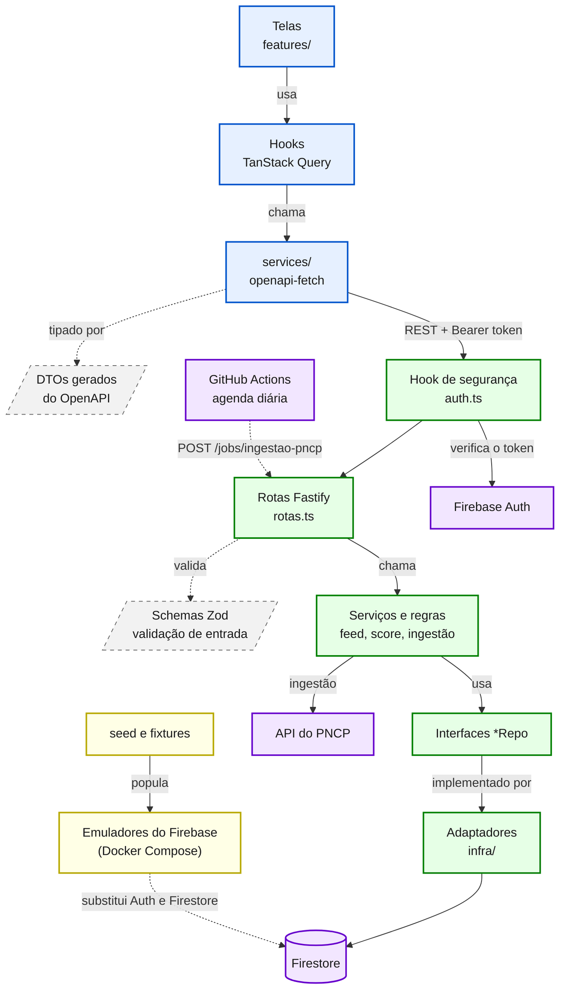

# Arquitetura do Projeto

Descreve o que está **implementado** no repositório de código [`LicitaRad4r/LicitaRadar`](https://github.com/LicitaRad4r/LicitaRadar). O que ainda é **planejado** nos ADRs aparece identificado como tal.

## Visão Geral

O LicitaRadar é um monorepo com o frontend (SPA em React) e o backend (API REST em Fastify) lado a lado. O backend é a única porta de acesso aos dados, que ficam no Firestore; a identidade vem do Firebase Auth. Uma rotina diária busca no PNCP os editais com proposta aberta e calcula o score de aderência de cada empresa.

```text
LicitaRadar/
├── client/                  # Frontend: React + Vite + TypeScript
│   ├── src/                 # features, services, components, lib, mocks, routes
│   ├── tests/               # Playwright: telas contra a API simulada
│   └── tests-e2e/           # Playwright: roteiro contra a API real
├── server/                  # Backend: Node.js + Fastify + Zod
│   ├── src/                 # módulos por funcionalidade + infra/ (adaptadores)
│   ├── tests/               # unit, contract, integration e fixtures do PNCP
│   └── openapi.yaml         # contrato da API (fonte da verdade front × back)
├── infra/firebase/          # Dockerfile dos emuladores do Firebase
├── .github/                 # CI, ingestão agendada, CODEOWNERS, template de PR
├── docker-compose.yml       # sobe emuladores, API e frontend
├── firebase.json            # configuração dos emuladores
├── firestore.rules          # regras deny-all
├── .env.example             # variáveis do ambiente local
└── README.md
```

## Separação de Responsabilidades



### Como ler o diagrama

| Cor | Camada | Responsabilidade |
| :--- | :--- | :--- |
| 🔵 **Azul** | Frontend | Telas, hooks de dados, chamadas HTTP tipadas pelo contrato |
| 🟢 **Verde** | Backend | Autenticação, rotas, validação, regras de negócio e acesso a dados |
| 🟣 **Roxo** | Serviços em nuvem | Firebase Auth, Firestore, API do PNCP e o agendador do GitHub Actions |
| 🟡 **Amarelo** | Dev local | Emuladores do Firebase, *seed* e fixtures, tudo no Docker Compose |

## Fluxo de uma Requisição

Exemplo: o usuário abre o feed de editais (`GET /v1/feed`).

```text
1. A tela PaginaFeed usa o hook useFeed(filtros), que guarda o resultado em cache (30 s).
2. O hook chama services/feed.ts, que usa o cliente openapi-fetch tipado pelo contrato.
3. services/http.ts acrescenta o cabeçalho Authorization: Bearer <ID token do Firebase>.
4. No Fastify, o hook onRequest valida o token no Firebase Auth (inválido: 401).
5. O hook preHandler confere que qualquer empresaId na query é o do token (diferente: 403).
6. A rota valida a query com o schema Zod ConsultaFeed (inválida: 400 VALIDACAO).
7. montarFeed lê editais e scores da empresa no Firestore, filtra, ordena e pagina.
8. A resposta JSON volta ao navegador e o EstadoDaConsulta mostra a lista (ou erro, ou vazio).
```

### Ambiente de Desenvolvimento

- **Tudo em Docker Compose:** `docker compose up --build` sobe os emuladores do Firebase, a API (porta 3333) e o frontend (porta 5173).
- **Dados locais:** `npm run seed` cria empresas, usuários com *claims* e editais de exemplo; `npm run ingest -- --fonte=fixtures` carrega editais pelo caminho real da ingestão, sem internet.
- **Sem Docker (opcional):** só para lint, build e testes, com Node.js 22 ou mais novo. O caminho suportado pelo time é o Compose.

## Zod e DTOs

**Schemas Zod** são a porta de entrada do backend: descrevem e validam, em tempo de execução, tudo o que chega de fora (corpo do perfil, *query string* do feed, payload do PNCP) e ao mesmo tempo geram o tipo TypeScript correspondente. Explicação completa em [Backend: Validação com Zod](backend.md#validacao-com-zod).

**Entidades** são interfaces TypeScript do domínio (`Edital`, `RegistroScore`, `CertidaoRegistro`), usadas pelas regras de negócio e pelos repositórios, sem depender do Firebase. **DTOs do frontend** são os tipos gerados de `server/openapi.yaml` (`npm run gen:api`), que garantem que as telas falem o mesmo formato da API.

## Planejado para o Checkpoint 3

Ainda **não está no código**: o acompanhamento de editais por etapas (US20, Jornada 2: Interessado, Preparando, Enviado e Resultado). Ele traz uma tela nova no frontend (`features/acompanhamento`) e quatro rotas novas no backend (ver [Backend: Rotas](backend.md#rotas)). Segue o mesmo caminho das demais funcionalidades: tela, hook, `services/`, rota Fastify com Zod, serviço e repositório no Firestore. Os critérios de aceite estão em [Histórias de Usuário](../backlog/historias.md).

## Documentação por Camada

- [Frontend](frontend.md): estrutura do SPA, acesso à API, sessão e estados de tela
- [Backend](backend.md): rotas, validação com Zod, segurança, score e ingestão
- [Banco de Dados](banco-de-dados.md): coleções do Firestore, claims, arquivos e cotas
- [Infraestrutura](InfraestruturaeSegurança/infraestrutura.md): Compose, CI, variáveis de ambiente e produção planejada

As decisões por trás de cada escolha estão nos [ADRs](decisoes_tecnicas.md).