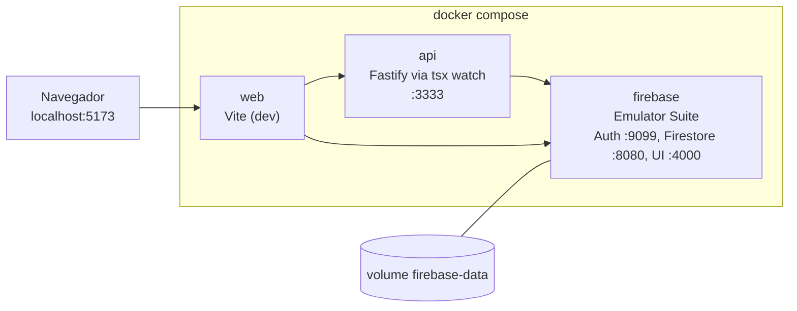
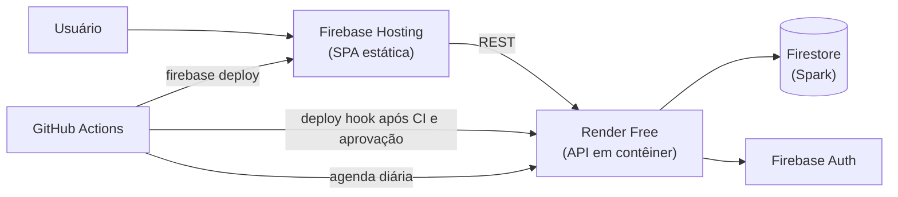

# Infraestrutura

## Ambiente Local (Docker Compose)

O único caminho suportado para desenvolver é `docker compose up --build`, na raiz do repositório de código ([como rodar](../../gestao_metodologia/como-rodar.md)). Ele sobe três serviços:

| Serviço | Base | Portas | Detalhes |
| :--- | :--- | :--- | :--- |
| `firebase` | Node 22 + Java 21 + `firebase-tools` 15 | 4000, 8080, 9099, 9150 | emuladores de Auth e Firestore com as regras `deny-all`; importa e exporta o estado no volume `firebase-data` |
| `api` | Node 22 | `API_PORT` (3333) | código montado como volume, `npm run dev` (`tsx watch`); só inicia com o emulador saudável |
| `web` | Node 22 | `WEB_PORT` (5173) | código montado como volume, `npm run dev` (Vite) |

`docker compose down` preserva os dados dos emuladores; `docker compose down -v` zera tudo. As variáveis ficam no `.env`, criado a partir do `.env.example` (o projeto Firebase `demo-licitaradar` roda sem GCP real).

As imagens atuais são **de desenvolvimento**: os Dockerfiles de `server/` e `client/` executam `npm run dev`.

## Integração Contínua

Workflow `.github/workflows/ci.yml`, em todo pull request e em *push* na `main`:

| Job | O que executa |
| :--- | :--- |
| `gitleaks` | varredura de segredos em todo o histórico |
| `client` | `npm ci`, `lint` (oxlint) e `build` (Node 22) |
| `server` | `npm ci`, `lint`, `build` e `test:unit` (Node 24) |
| `compose` | `docker compose config --quiet` com o `.env.example` |

O repositório também define `CODEOWNERS` por área (frontend, backend, testes, infra) e um template de pull request. O que falta no CI está em [Testes](../../Testes/estrategia_de_testes.md#pontos-de-atencao).

## Ingestão Agendada

`.github/workflows/ingestao-pncp.yml` roda todo dia às 06:00 UTC (03:00 em Brasília) e pode ser disparado à mão (`workflow_dispatch`). Ele chama `POST {API_BASE_URL}/jobs/ingestao-pncp` com o `INGEST_JOB_TOKEN`. O job só executa se a variável do repositório `ENABLE_PNCP_INGEST` for `true` e exige os *secrets* `API_BASE_URL` e `INGEST_JOB_TOKEN`. O fluxo da ingestão está em [Backend](../backend.md#ingestao-do-pncp).

## Documentação

O repositório `documentation` publica o site no GitHub Pages (`deploy-pages.yml`: `mkdocs build --strict` e depois o deploy). Como o *build* é estrito, qualquer link ou entrada de menu quebrada impede a publicação.

## Produção (planejada)

Nada abaixo está publicado hoje. É o desenho dos ADRs 0001, 0003, 0004 e 0010, todos ainda **Propostos** (aguardando o registro da aprovação do Custo Zero).

- A API no Render Free **dorme após 15 minutos** sem requisições e leva cerca de 1 minuto para voltar. O ADR-0003 manda o frontend tratar isso com estado de carregamento e nova tentativa na primeira chamada; o job de ingestão, que chama a API, sofre o mesmo atraso.
- O ADR-0004 prevê um segundo serviço Render e um segundo projeto Firebase para *staging*.
- O monitoramento previsto no plano Custo Zero é o UptimeRobot consultando `/readyz` a cada 5 minutos, com alerta por e-mail. Falta registrar essa escolha em ADR e conferir com o ADR-0004, que proíbe pings para manter a API acordada.
- Segredos ficam em GitHub Actions Secrets (CI e deploy) e variáveis do Render (execução).

## Variáveis de Ambiente da API

| Variável | Para quê | Padrão |
| :--- | :--- | :--- |
| `PORT` | porta da API | 3333 |
| `GCLOUD_PROJECT` | id do projeto Firebase | `demo-licitaradar` |
| `FIRESTORE_EMULATOR_HOST`, `FIREBASE_AUTH_EMULATOR_HOST` | apontam o Admin SDK para os emuladores (definidas no Compose) | não definidas |
| `FIREBASE_SERVICE_ACCOUNT_JSON` | JSON da conta de serviço fora do emulador; sem ela vale a credencial padrão do ambiente | não definida |
| `CORS_ORIGENS` | origens do frontend aceitas, separadas por vírgula | `http://localhost:5173` |
| `INGEST_JOB_TOKEN` | token da rota do job (use 32 ou mais caracteres aleatórios) | sem ele a rota recusa tudo |
| `INGEST_FONTE` | `pncp` ou `fixtures` | `pncp` |
| `INGEST_PERMITIR_FIXTURES` | permite fixtures fora do emulador | não definida |
| `INGEST_PERMITIR_ESCRITA_REAL` | permite o `npm run ingest` gravar fora do emulador | não definida |
| `PNCP_BASE_URL`, `PNCP_DIAS_A_FRENTE`, `PNCP_MAX_PAGINAS`, `PNCP_INTERVALO_MS` | ajustes do cliente do PNCP | API oficial, 30 dias, 3 páginas, 5000 ms |
| `ARQUIVOS_DIR` | pasta dos arquivos de certidão | `./.arquivos` |

As variáveis do frontend estão em [Frontend](../frontend.md#variaveis-de-ambiente).

## Custo e Cotas

O projeto tem teto de custo de **US$ 0**: nenhum cartão cadastrado e nenhum upgrade para o plano Blaze. Sem alertas de orçamento, o acompanhamento é por prints dos painéis de cada serviço, em `docs/finops/` (ver [FinOps](../finops/README.md)). As cotas do Firestore estão em [Banco de Dados](../banco-de-dados.md#cotas-do-firestore-plano-spark).