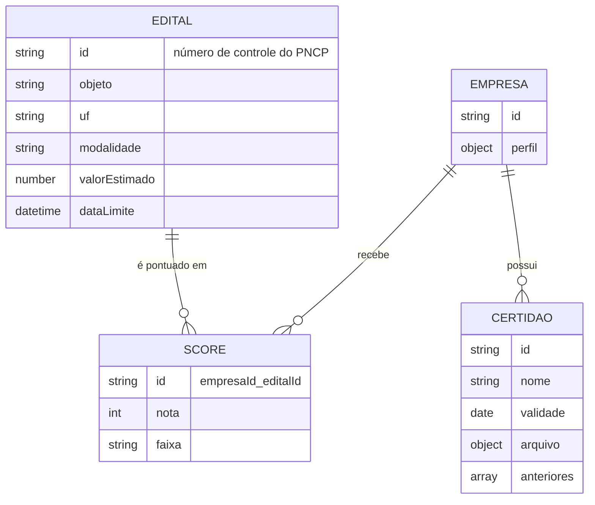

# Banco de Dados

Hoje **todo o dado da aplicação está no Cloud Firestore**, acessado só pela API (Admin SDK). A identidade fica no Firebase Auth e os arquivos de certidão ficam em disco local.

## Coleções do Firestore

| Coleção | ID do documento | Escopo | Conteúdo | Escrita | Leitura |
| :--- | :--- | :--- | :--- | :--- | :--- |
| `empresas` | gerado pelo Firestore | uma por empresa | `perfil` (ufs, termosChave, segmentos, modalidades, valorMinimo, valorMaximo, prazoMinimoDiasUteis) e `criadaEm` | `PUT /v1/perfil` | API e ingestão |
| `editais` | número de controle do PNCP, com `/` e caracteres especiais trocados por `-` | **global** (compartilhado por todas as empresas) | objeto, descrição, órgão, UF, município, modalidade, segmento, valor estimado, publicação e prazo (`dataLimite`) | ingestão | API (feed) |
| `scores` | `{empresaId}_{editalId}` | por empresa (campo `empresaId`) | `empresaId`, `editalId`, `nota`, `faixa` | ingestão | API (feed) |
| `certidoes` | definido no *seed* (a criação pela API ainda não existe) | por empresa (campo `empresaId`) | nome, validade (`AAAA-MM-DD`), arquivo ativo e lista `anteriores` | API (renovação) | API |

Os relacionamentos são lógicos (o Firestore não impõe integridade referencial): o feed cruza `scores` com `editais` em memória e ignora score cujo edital não existe mais. Os dados que entram nas coleções passam antes pelos schemas Zod descritos em [Backend](backend.md#validacao-com-zod).

## Identidade e Claims

O Firebase Auth guarda os usuários. A empresa e o papel viajam como *custom claims* do ID token:

| Claim | Valores | Quem grava |
| :--- | :--- | :--- |
| `empresaId` | id do documento em `empresas` (a API também aceita `orgId` como sinônimo) | a API, no primeiro `PUT /v1/perfil` |
| `role` | `decisor` ou `analista` | a API (quem cria a empresa vira `decisor`) |

Depois de gravar os *claims*, o cliente precisa renovar o token (`getIdToken(true)`). Ainda não há rota para convidar um segundo usuário ou mudar papéis; os usuários `analista` existem hoje só pelo *seed*.

## Regras de Segurança e Isolamento

`firestore.rules` nega leitura e escrita a qualquer cliente (`allow read, write: if false`). A API usa o Admin SDK, que **ignora** as Security Rules, portanto **o isolamento entre empresas é feito no código da API**: o `empresaId` vem do token e as consultas de `scores` e `certidoes` sempre filtram por ele. O teste `tests/integration/firestore-deny.all.test.ts` confirma o `deny-all` contra o emulador.

## Arquivos de Certidão

A chave do arquivo é `certidoes/{empresaId}/{certidaoId}/{timestamp}-{uuid curto}.{pdf|jpg|png}`, gravada em disco na pasta `ARQUIVOS_DIR` (padrão `./.arquivos`, ignorada pelo Git). Renovações **não apagam** o arquivo anterior: ele passa para `anteriores`.

Esse armazenamento serve ao desenvolvimento. Não há rota de download e o disco de um contêiner em hospedagem gratuita não é durável, então **o armazenamento de produção é uma decisão em aberto** (precisa respeitar o Custo Zero).

## Dados de Demonstração

`npm run seed` (com o emulador no ar) cria duas empresas com perfis diferentes, três usuários com *claims* (`decisor.a@`, `analista.a@` e `decisor.b@licitaradar.local`), o conjunto *golden* de editais, os scores de cada par empresa × edital e as certidões. `npm run ingest -- --fonte=fixtures` carrega editais de demonstração pelo caminho real da ingestão, sem internet. O `seed` só roda no emulador; o `ingest` recusa gravar fora dele sem `INGEST_PERMITIR_ESCRITA_REAL=true`.

## Cotas do Firestore (plano Spark)

Pelo ADR-0005, o plano Spark permite 50 mil leituras, 20 mil escritas e 20 mil exclusões por dia, e 1 GiB de armazenamento. Ao esgotar uma cota, o Firestore recusa as operações até o dia seguinte.