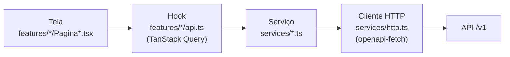

# Frontend

SPA em React 19 com Vite e TypeScript, estilizada com Tailwind CSS 4 e componentes shadcn/ui (sobre Base UI). Fica em `client/` do repositório de código.

## Visão Geral

```text
client/src/
├── routes/        # rotas (React Router) e Layout das páginas logadas
├── features/      # uma pasta por jornada: acesso, feed, certidoes, perfil, editais
├── services/      # chamadas HTTP, uma função por rota da API, tipadas pelo contrato
├── components/    # componentes compartilhados (ui/, estado/, Paginacao)
├── lib/           # sessão, Firebase, cache (TanStack Query), formatação, datas
├── mocks/         # API simulada (MSW) para desenvolvimento e testes
└── testes/        # utilitários de teste
```

| Tecnologia | Para quê |
| :--- | :--- |
| React 19 + Vite | SPA e servidor de desenvolvimento |
| TypeScript | tipagem de ponta a ponta, incluindo os DTOs gerados do OpenAPI |
| Tailwind CSS 4 + shadcn/ui | estilo e componentes acessíveis |
| React Router | rotas e proteção das páginas logadas |
| TanStack Query | cache e estado das chamadas à API |
| openapi-fetch | cliente HTTP tipado pelo contrato |
| React Hook Form + Zod | formulários e leitura segura dos filtros da URL |
| Firebase Auth (SDK) | login e ID token |
| MSW | API simulada |

## Como uma Tela Busca Dados

Três camadas, cada uma com uma função:



1. **`services/`** tem uma função por rota, tipada com os DTOs gerados de `server/openapi.yaml`.
2. **Hooks** chamam os serviços pelo TanStack Query, que guarda o resultado em cache (`staleTime` de 30 s; erros `4xx` não são repetidos) e atualiza as listas depois de uma ação.
3. **Telas** usam só os hooks: não chamam `fetch` nem montam URL.

O cliente HTTP (`services/http.ts`) injeta o `Authorization: Bearer` em toda chamada e **avisa num lugar só** todo `401` e todo `403 ACESSO_NEGADO`. Quem decide o que fazer (voltar ao login ou abrir "Acesso negado") é o `TratamentoDeAcesso`, no Layout. O `403 EMPRESA_NAO_CONFIGURADA` não é falta de permissão e aparece na própria tela.

**Contrato tipado:** `npm run gen:api` gera `services/schema.d.ts` a partir de `server/openapi.yaml`. Se o contrato mudar e algum hook ou tela deixar de compilar, o `npm run build` acusa na hora.

## Estados de Tela

Toda lista passa pelo componente `EstadoDaConsulta`, que resolve os quatro estados: **carregando** (esqueleto), **erro** (mensagem em português e "Tentar novamente"), **vazio** (cada tela diz o próximo passo) e **sucesso**. Em formulários, o erro aparece nos campos, não em *toast*.

## Sessão e Acesso

A sessão fica em `lib/sessao.ts`, atrás da interface `ProvedorSessao` (`entrar`, `sair`, `token`, `renovar`, `observar`). Há dois provedores:

- **Firebase Auth** (`lib/firebase.ts`): usado com a API real, no emulador ou em produção.
- **Sessão simulada** (`mocks/sessao.ts`): usada com a API mockada, com os mesmos usuários do *seed* do servidor.

Empresa e papel (`decisor` ou `analista`) vêm dos *claims* do ID token. Depois do primeiro `PUT /v1/perfil`, quando a API grava os *claims*, o hook `useSalvarPerfil` renova o token sozinho. Ao sair, o cache da API é limpo, porque os dados eram da empresa daquela pessoa.

## Rotas

| Caminho | Tela | Observação |
| :--- | :--- | :--- |
| `/login` | `PaginaLogin` | fora do Layout |
| `/` | `PaginaFeed` | feed ranqueado, com filtros guardados na URL |
| `/certidoes` | `PaginaCertidoes` | só `decisor`; o menu esconde o item para o `analista` |
| `/acesso-negado` | `PaginaAcessoNegado` | destino do `403 ACESSO_NEGADO` |
| `*` | `PaginaNaoEncontrada` | |

Tudo dentro do Layout exige sessão: sem login, a pessoa vai para `/login` e volta ao ponto de origem depois de entrar. O cabeçalho mostra a saúde da API (consulta `/health` a cada 60 s).

## Zod no Frontend

O frontend também usa o Zod, em dois lugares, com um objetivo diferente do backend: **melhorar a experiência**, nunca substituir a validação do servidor.

| Onde | Arquivo | O que faz |
| :--- | :--- | :--- |
| Formulário de renovação de certidão | `features/certidoes/FormularioRenovacao.tsx` | com `zodResolver` do React Hook Form, valida arquivo (um só, não vazio, PDF/JPG/PNG, até 5 MB) e nova validade (depois de hoje e da validade atual) antes de enviar, e mostra a mensagem no campo |
| Filtros do feed na URL | `features/feed/filtros.ts` | lê `?q=…&uf=…&page=…` com um schema que usa `.catch(...)`: valor inválido vira o padrão em vez de quebrar a tela; UFs são normalizadas e faixa de valor invertida tem as pontas trocadas |

As regras do formulário espelham as do servidor (5 MB, tipos aceitos, validade futura). Se o servidor ainda recusar, o erro `400` volta com `detalhes[].campo` e é exibido no mesmo campo. Veja o funcionamento do Zod em [Backend](backend.md#validacao-com-zod).

## API Simulada (Mock)

Com `VITE_API_MOCK=true`, o frontend usa o mock em `src/mocks` (MSW), que segue o contrato e guarda as alterações enquanto a página estiver aberta. A URL aceita `?mock=vazio`, `descartados`, `erro`, `lento`, `sem-login` e `sem-empresa` para forçar um estado, e `?papel=analista` para simular o analista. Com `VITE_API_MOCK=false`, o app conversa com a API real.

## Variáveis de Ambiente

| Variável | Para quê |
| :--- | :--- |
| `VITE_API_URL` | endereço da API |
| `VITE_API_MOCK` | `true` usa o mock; `false` usa a API real |
| `VITE_FIREBASE_API_KEY`, `VITE_FIREBASE_AUTH_DOMAIN`, `VITE_FIREBASE_PROJECT_ID` | obrigatórias com a API real fora do emulador; se faltar alguma, o app abre uma página que lista o que falta |
| `VITE_FIREBASE_AUTH_EMULATOR_URL` | aponta o SDK para o emulador de Auth no ambiente local |