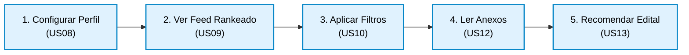
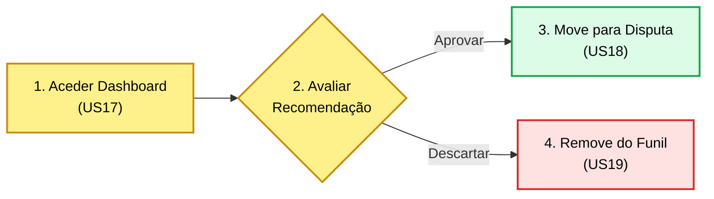
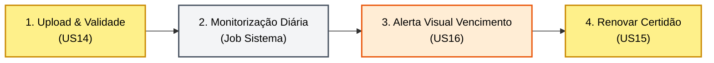
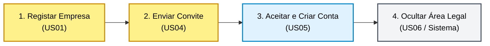

# Jornadas de Utilizador (Checkpoint 2)

Este documento mapeia as 4 jornadas ponta a ponta do LicitaRadar. Cada fluxo descreve a experiência do utilizador desde o gatilho inicial até à retenção, garantindo o alinhamento total entre a modelação do negócio e as Histórias de Utilizador (US) exigidas no Checkpoint 2.

---

## Jornada 1 — Mariana (Analista) faz a Triagem de Oportunidades

1. **Descoberta:** Mariana tem a tarefa diária e frustrante de procurar novos editais em múltiplos diários oficiais governamentais, perdendo muito tempo com PDFs irrelevantes.
2. **Onboarding / Preparação:** Ela entra no LicitaRadar e configura o perfil da sua empresa, definindo palavras-chave (ex: "software", "computador"), estados de interesse e faixa de valor aceitável (US08).
3. **Ação Principal:** O sistema faz o trabalho pesado. Ela abre o seu *Feed* e visualiza uma lista de editais do PNCP já ranqueada pelo Score de Aderência (US09). Aplica filtros para refinar a busca (US10) e analisa os anexos dos editais mais promissores (US12).
4. **Retenção / Acompanhamento:** Mariana clica na "Estrela" para recomendar os melhores editais (US13). Ela acede à plataforma diariamente porque o motor traz novas licitações de forma automática.

---

## Jornada 2 — Bruno (Decisor) avalia o Funil de Editais

1. **Descoberta:** Bruno precisa de decidir em quais processos a empresa vai gastar recursos para concorrer, mas não tem tempo para ler centenas de editais brutos.
2. **Onboarding / Preparação:** Ele acede ao seu Dashboard de Decisão exclusivo. O sistema filtra o ruído e exibe apenas os editais que a Mariana marcou como "Recomendados" (US17).
3. **Ação Principal:** Bruno avalia rapidamente o resumo e os valores de cada oportunidade recomendada. Ele decide "Aprovar" o edital para iniciar a montagem da proposta (US18) ou "Descartar", removendo-o da fila (US19).
4. **Retenção / Acompanhamento:** Os editais aprovados movem-se para a fila "Em Disputa", permitindo que Bruno acompanhe visualmente o pipeline de vendas B2B da sua empresa.

---

## Jornada 3 — Bruno (Decisor) gere a Conformidade Documental

1. **Descoberta:** Bruno sabe que vencer uma licitação não serve de nada se a empresa for inabilitada por ter uma Certidão Negativa de Débitos vencida no dia da disputa.
2. **Onboarding / Preparação:** Durante a configuração inicial da conta, Bruno faz o upload de todas as certidões legais da empresa e cadastra as datas de validade exatas de cada uma (US14).
3. **Ação Principal:** O sistema monitoriza os prazos de forma silenciosa. Certo dia, ao aceder à plataforma, Bruno depara-se com um alerta visual 🔴 indicando que uma certidão expira em 12 dias (US16).
4. **Retenção / Acompanhamento:** Bruno obtém o novo documento no órgão emissor, faz a renovação e substituição do ficheiro na plataforma (US15). O alerta é neutralizado e a conformidade mantida.

---

## Jornada 4 — A Equipa faz Onboarding com Isolamento de Segurança

1. **Descoberta:** A organização decidiu adotar o LicitaRadar. Bruno precisa de colocar a sua Analista a trabalhar na plataforma, mas exige que ela não tenha acesso aos dados financeiros e certidões confidenciais da empresa.
2. **Onboarding / Preparação:** Bruno cria a conta matriz da empresa (US01) e envia um convite seguro diretamente para o e-mail corporativo de Mariana (US04).
3. **Ação Principal:** Mariana clica no link, cadastra a sua palavra-passe pessoal e entra no sistema. O seu perfil é automaticamente vinculado à empresa do Bruno com o nível hierárquico inferior de "Analista" (US05).
4. **Retenção / Acompanhamento:** A confiança no sistema é estabelecida pelo isolamento arquitetural: sempre que Mariana navega na aplicação, a aba de "Documentação Legal e Financeira" permanece rigorosamente oculta e bloqueada (US06).

