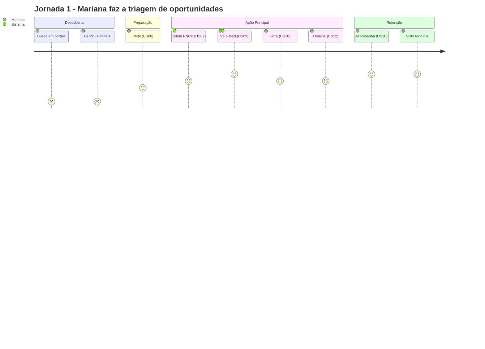
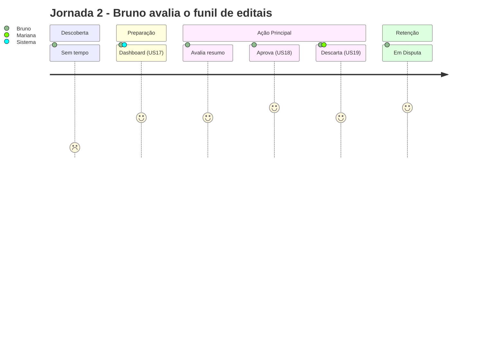
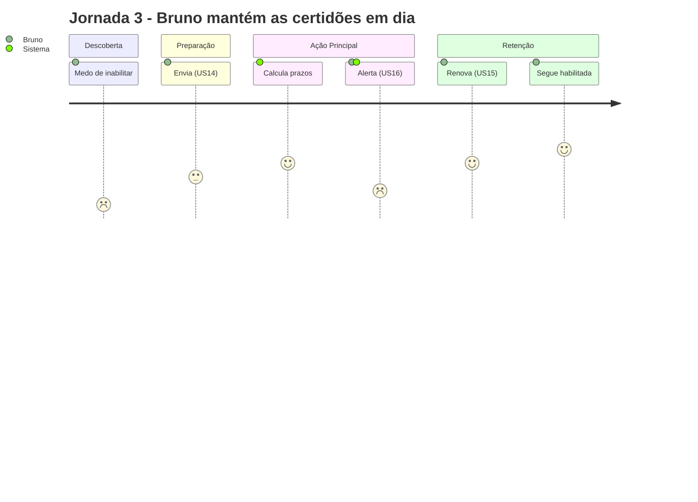
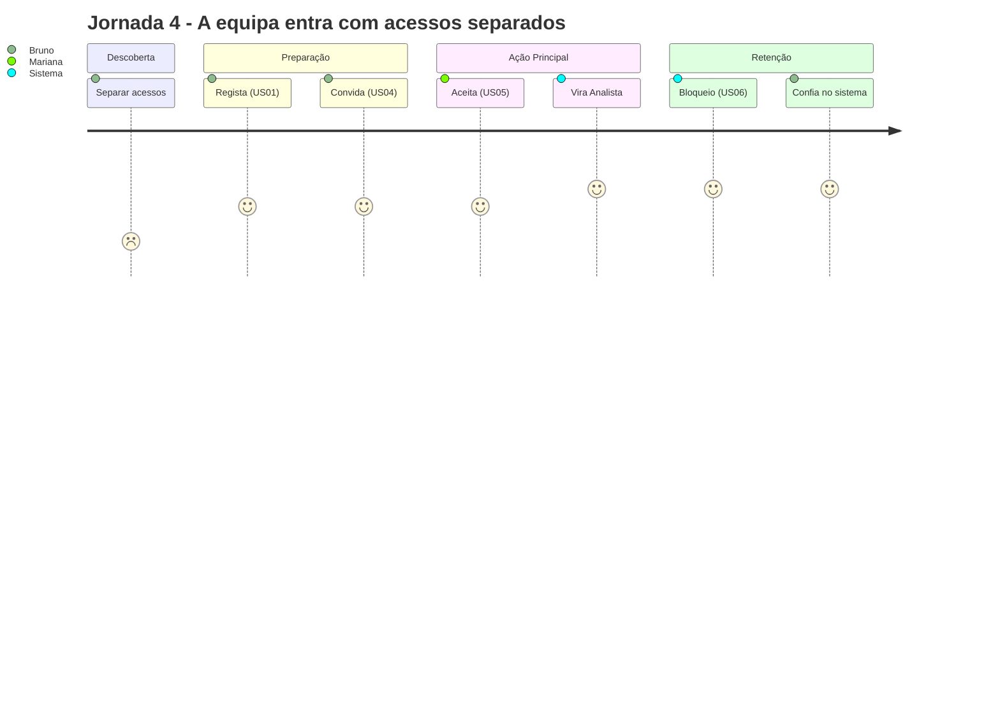
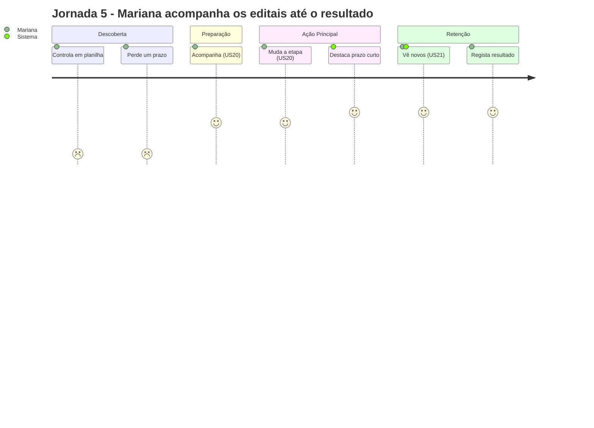

# Jornadas de Utilizador

Este documento mapeia as 5 jornadas ponta a ponta do LicitaRadar. Cada jornada descreve a experiência do utilizador desde o gatilho inicial até à retenção e liga cada etapa às Histórias de Utilizador (US).

!!! info "Como ler os diagramas de jornada"
    - Cada **secção** é uma fase da jornada: Descoberta, Preparação, Ação Principal e Retenção.
    - Cada linha é uma etapa, com a história correspondente entre parênteses e **quem participa** (Mariana, Bruno ou o Sistema).
    - A **nota de 1 a 5** é a satisfação do utilizador naquela etapa: 1 é frustração, 5 é muito satisfeito. As notas baixas mostram a dor que o LicitaRadar resolve.

| Jornada | No MVP? |
| :--- | :--- |
| 1 — Triagem de oportunidades | Sim. No último passo, a Mariana passa a **acompanhar** o edital (Jornada 5). |
| 2 — Funil de decisão do Decisor | **Após o MVP.** Ver o [Escopo do MVP](negocio/visao/escopo.md). |
| 3 — Conformidade documental | Sim. |
| 4 — Onboarding com isolamento de segurança | Sim, com as contas criadas por script. O convite por e-mail fica para depois do MVP. |
| 5 — Acompanhamento até o resultado | Sim. Nova no MVP. |

---

## Jornada 1 — Mariana (Analista) faz a Triagem de Oportunidades

1. **Descoberta:** Mariana tem a tarefa diária e frustrante de procurar novos editais em múltiplos diários oficiais governamentais, perdendo muito tempo com PDFs irrelevantes.
2. **Onboarding / Preparação:** Ela entra no LicitaRadar e configura o perfil da sua empresa, definindo palavras-chave (ex: "software", "computador"), estados de interesse e faixa de valor aceitável (US08).
3. **Ação Principal:** O sistema faz o trabalho pesado. Ela abre o seu *Feed* e visualiza uma lista de editais do PNCP já ranqueada pelo Score de Aderência (US09). Aplica filtros para refinar a busca (US10) e abre o detalhe dos editais mais promissores (US12).
4. **Retenção / Acompanhamento:** Mariana clica em "Acompanhar" nos melhores editais (US20), que seguem para a Jornada 5. Ela acede à plataforma diariamente porque a ingestão traz novas licitações de forma automática (US07).

---

## Jornada 2 — Bruno (Decisor) avalia o Funil de Editais

!!! note "Após o MVP"
    Esta jornada ficou fora do MVP. No lugar dela entra a Jornada 5, de acompanhamento. Ver o [Escopo do MVP](negocio/visao/escopo.md).

1. **Descoberta:** Bruno precisa de decidir em quais processos a empresa vai gastar recursos para concorrer, mas não tem tempo para ler centenas de editais brutos.
2. **Onboarding / Preparação:** Ele acede ao seu Dashboard de Decisão exclusivo. O sistema filtra o ruído e exibe apenas os editais que a Mariana marcou como "Recomendados" (US17).
3. **Ação Principal:** Bruno avalia rapidamente o resumo e os valores de cada oportunidade recomendada. Ele decide "Aprovar" o edital para iniciar a montagem da proposta (US18) ou "Descartar", removendo-o da fila (US19).
4. **Retenção / Acompanhamento:** Os editais aprovados movem-se para a fila "Em Disputa", permitindo que Bruno acompanhe visualmente o pipeline de vendas B2B da sua empresa.

---

## Jornada 3 — Bruno (Decisor) gere a Conformidade Documental

1. **Descoberta:** Bruno sabe que vencer uma licitação não serve de nada se a empresa for inabilitada por ter uma Certidão Negativa de Débitos vencida no dia da disputa.
2. **Onboarding / Preparação:** Durante a configuração inicial da conta, Bruno faz o upload de todas as certidões legais da empresa e cadastra as datas de validade exatas de cada uma (US14).
3. **Ação Principal:** O sistema calcula os prazos a cada consulta. Certo dia, ao aceder à plataforma, Bruno depara-se com um alerta "Urgente" indicando que uma certidão expira em 12 dias (US16).
4. **Retenção / Acompanhamento:** Bruno obtém o novo documento no órgão emissor, faz a renovação e substituição do ficheiro na plataforma (US15). O alerta desaparece e a conformidade é mantida.

---

## Jornada 4 — A Equipa faz Onboarding com Isolamento de Segurança

1. **Descoberta:** A organização decidiu adotar o LicitaRadar. Bruno precisa de colocar a sua Analista a trabalhar na plataforma, mas exige que ela não tenha acesso às certidões da empresa.
2. **Onboarding / Preparação:** Bruno cria a conta da empresa (US01) e envia um convite seguro diretamente para o e-mail corporativo de Mariana (US04).
3. **Ação Principal:** Mariana clica no link, cadastra a sua palavra-passe pessoal e entra no sistema. O seu perfil é automaticamente vinculado à empresa do Bruno com o papel de "Analista" (US05).
4. **Retenção / Acompanhamento:** A confiança no sistema vem do isolamento: sempre que Mariana navega na aplicação, a área de "Certidões" permanece oculta e a API recusa o acesso (US06).

---

## Jornada 5 — Mariana (Analista) acompanha os editais até o resultado

1. **Descoberta:** Depois de escolher os editais, a equipa controla o andamento numa planilha. Um prazo passa despercebido e a proposta não é enviada a tempo.
2. **Onboarding / Preparação:** No feed, Mariana clica em "Acompanhar" nos editais que a empresa vai disputar. Eles entram na lista "Acompanhados" com a etapa "Interessado" (US20).
3. **Ação Principal:** Conforme o trabalho avança, Mariana muda a etapa para "Preparando" e depois "Enviado". A lista ordena pelo prazo mais próximo e destaca os que vencem em até 3 dias úteis (US20).
4. **Retenção / Acompanhamento:** Ao abrir a plataforma, Mariana vê quantos editais novos chegaram (US21) e, na mesma visita, confere o que está perto do prazo. Quando sai o resultado, regista-o e o edital fecha o ciclo.

