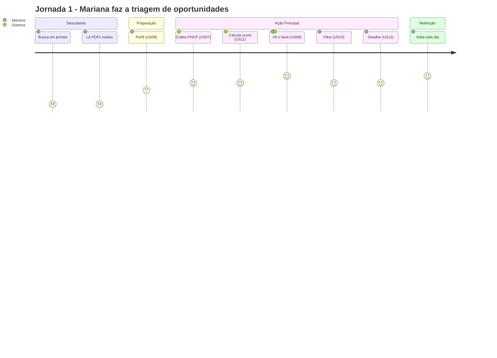
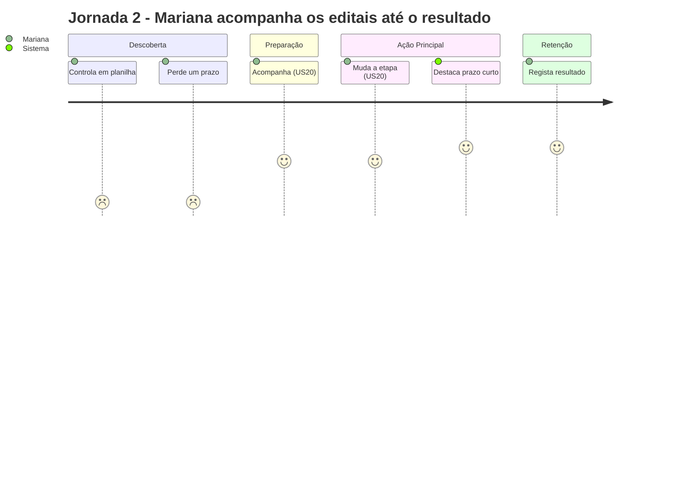
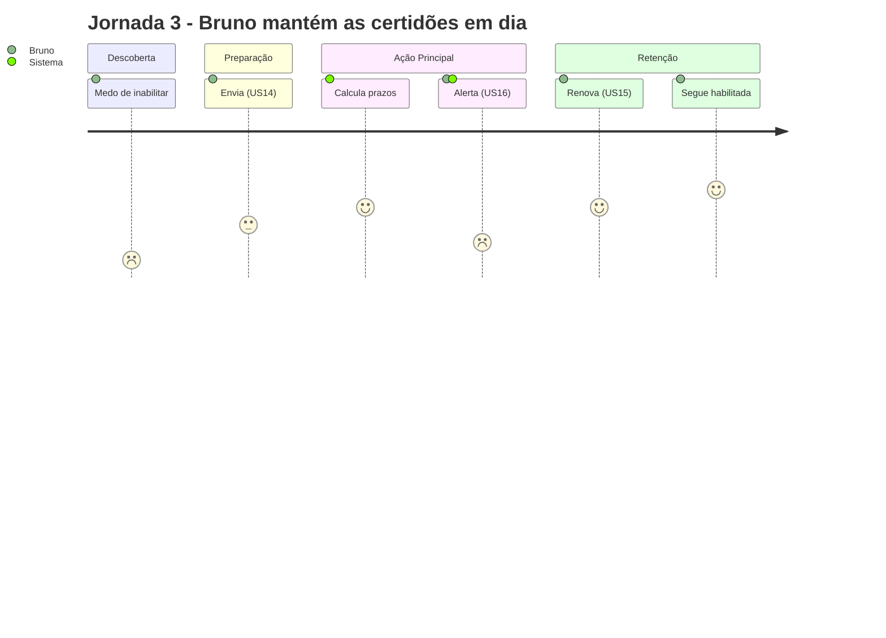
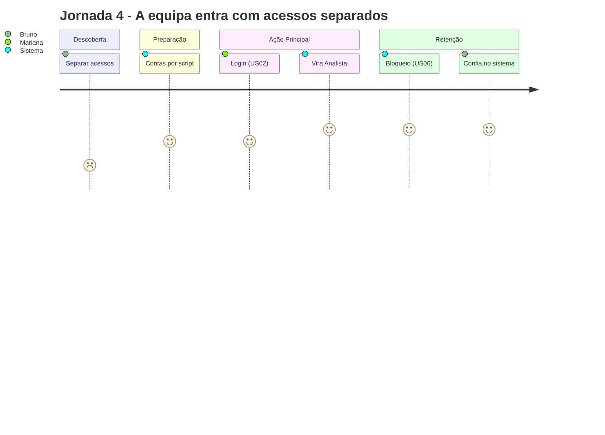

# Jornadas de Utilizador

Este documento mapeia as jornadas ponta a ponta do LicitaRadar. Cada jornada descreve a experiência do utilizador desde o gatilho inicial até à retenção e liga cada etapa às Histórias de Utilizador (US).

As jornadas estão ordenadas por prioridade: primeiro as que entram no MVP, depois a condicional e, no fim, a que fica para depois do MVP.

!!! info "Como ler os diagramas de jornada"
    - Cada **secção** é uma fase da jornada: Descoberta, Preparação, Ação Principal e Retenção.
    - Cada linha é uma etapa, com a história correspondente entre parênteses e **quem participa** (Mariana, Bruno ou o Sistema).
    - A **nota de 1 a 5** é a satisfação do utilizador naquela etapa: 1 é frustração, 5 é muito satisfeito. As notas baixas mostram a dor que o LicitaRadar resolve.

## Visão geral

| Jornada | Persona | Histórias | No MVP? |
| :--- | :--- | :--- | :--- |
| 1 — Triagem de oportunidades | Mariana (Analista) | US07, US08, US09, US10, US11, US12 | **Sim.** |
| 2 — Acompanhamento até o resultado | Mariana (Analista) | US20 | **Condicional.** Entra se a US20 estiver em PR até 15/11/2026. |
| 3 — Conformidade documental | Bruno (Decisor) | US14, US15, US16 | **Sim.** O alerta de vencimento (US16) é o alerta do MVP. |
| 4 — Acesso com isolamento de segurança | Bruno e Mariana | US02, US06 | **Sim**, com as contas criadas por script de seed. |
| 5 — Funil de decisão do Decisor | Bruno (Decisor) | US13, US17, US18, US19 | **Após o MVP.** |

Detalhes e justificativas no [Escopo do MVP](negocio/visao/escopo.md).

??? note "Correspondência com o Escopo do MVP e com os testes"
    O Escopo do MVP numera as jornadas do Caderno, e a Matriz de Rastreabilidade numera as frentes de teste. As numerações são diferentes desta página:

    | Esta página | Escopo do MVP (Caderno) | Matriz de testes |
    | :--- | :--- | :--- |
    | 1 — Triagem | 1 (perfil) e 2 (feed) | Jornada 1 (Feed) e Jornada 2 (Filtros) |
    | 2 — Acompanhamento | 3 (acompanhar edital) | — |
    | 3 — Conformidade | 4 (certidões) e 5 (alertas) | Jornada 3 (Certidões) |
    | 4 — Acesso | Acesso e segurança | Jornada 4 (Segurança) |
    | 5 — Funil do Decisor | Fora do MVP | — |

---

## Jornada 1 — Mariana (Analista) faz a Triagem de Oportunidades

1. **Descoberta:** Mariana tem a tarefa diária e frustrante de procurar novos editais em múltiplos diários oficiais governamentais, perdendo muito tempo com PDFs irrelevantes.
2. **Onboarding / Preparação:** Ela entra no LicitaRadar e configura o perfil da sua empresa, definindo palavras-chave (ex: "software", "computador"), estados de interesse, modalidades e faixa de valor aceitável (US08).
3. **Ação Principal:** O sistema faz o trabalho pesado: a ingestão diária traz os editais do PNCP (US07) e calcula o Score de Aderência (US11). Mariana abre o seu *Feed* e visualiza a lista já ranqueada (US09). Aplica filtros para refinar a busca (US10) e abre o detalhe dos editais mais promissores (US12).
4. **Retenção / Acompanhamento:** Mariana acede à plataforma diariamente porque a ingestão traz novas licitações de forma automática. Se a Jornada 2 entrar no MVP, ela clica em "Acompanhar" nos melhores editais (US20).

---

## Jornada 2 — Mariana (Analista) acompanha os editais até o resultado

!!! warning "Condicional"
    Esta jornada entra no MVP se a US20 estiver em PR até 15/11/2026. Caso contrário, passa para depois do MVP. Ver o [Escopo do MVP](negocio/visao/escopo.md).

1. **Descoberta:** Depois de escolher os editais, a equipa controla o andamento numa planilha. Um prazo passa despercebido e a proposta não é enviada a tempo.
2. **Onboarding / Preparação:** No feed, Mariana clica em "Acompanhar" nos editais que a empresa vai disputar. Eles entram na lista "Acompanhados" com a etapa "Interessado" (US20).
3. **Ação Principal:** Conforme o trabalho avança, Mariana muda a etapa para "Preparando" e depois "Enviado". A lista ordena pelo prazo mais próximo e destaca os que vencem em até 3 dias (dias corridos) (US20).
4. **Retenção / Acompanhamento:** Ao abrir a lista "Acompanhados", Mariana confere o que está perto do prazo. Quando sai o resultado, regista "Venceu" ou "Não venceu" e o edital fecha o ciclo.

---

## Jornada 3 — Bruno (Decisor) gere a Conformidade Documental

1. **Descoberta:** Bruno sabe que vencer uma licitação não serve de nada se a empresa for inabilitada por ter uma Certidão Negativa de Débitos vencida no dia da disputa.
2. **Onboarding / Preparação:** Bruno faz o upload das certidões legais da empresa e cadastra as datas de validade exatas de cada uma (US14).
3. **Ação Principal:** O sistema calcula os prazos a cada consulta. Certo dia, ao aceder à plataforma, Bruno depara-se com um alerta "Urgente" indicando que uma certidão expira em 12 dias (US16).
4. **Retenção / Acompanhamento:** Bruno obtém o novo documento no órgão emissor, faz a renovação e substituição do ficheiro na plataforma (US15). O alerta desaparece e a conformidade é mantida.

---

## Jornada 4 — A Equipa entra com Acessos Separados

!!! note "Versão do MVP"
    No MVP, as empresas e os utilizadores são criados por script de seed. O cadastro self-service (US01) e o convite por e-mail (US04, US05) ficam para depois do MVP.

1. **Descoberta:** A organização decidiu adotar o LicitaRadar. Bruno precisa de colocar a sua Analista a trabalhar na plataforma, mas exige que ela não tenha acesso às certidões da empresa.
2. **Onboarding / Preparação:** As contas da empresa são criadas por script: Bruno como Decisor e Mariana como Analista, ligados à mesma empresa.
3. **Ação Principal:** Mariana faz login com e-mail e palavra-passe (US02). O token identifica o seu papel de "Analista" e a empresa a que pertence.
4. **Retenção / Acompanhamento:** A confiança no sistema vem do isolamento: sempre que Mariana navega na aplicação, a área de "Certidões" permanece oculta e a API recusa o acesso; nenhuma empresa vê os dados de outra (US06).

---

## Jornada 5 — Bruno (Decisor) avalia o Funil de Editais

!!! note "Após o MVP"
    Esta jornada ficou fora do MVP. No lugar dela entra a Jornada 2, de acompanhamento. Ver o [Escopo do MVP](negocio/visao/escopo.md).

1. **Descoberta:** Bruno precisa de decidir em quais processos a empresa vai gastar recursos para concorrer, mas não tem tempo para ler centenas de editais brutos.
2. **Onboarding / Preparação:** Ele acede ao seu Dashboard de Decisão exclusivo. O sistema filtra o ruído e exibe apenas os editais que a Mariana marcou como "Recomendados" (US13, US17).
3. **Ação Principal:** Bruno avalia rapidamente o resumo e os valores de cada oportunidade recomendada. Ele decide "Aprovar" o edital para iniciar a montagem da proposta (US18) ou "Descartar", removendo-o da fila (US19).
4. **Retenção / Acompanhamento:** Os editais aprovados movem-se para a fila "Em Disputa", permitindo que Bruno acompanhe visualmente o pipeline de vendas B2B da sua empresa.

